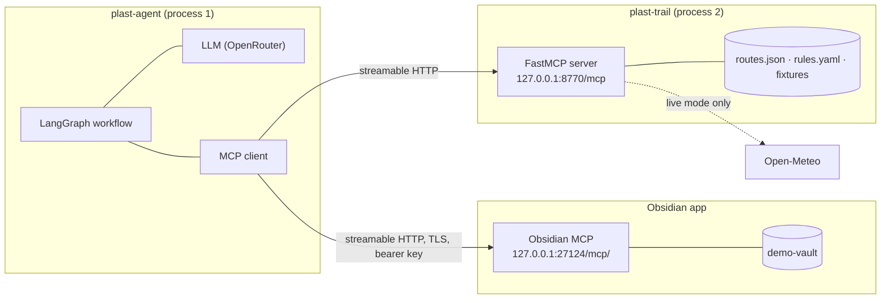

# plast-hike-planner

**Lab 1 · MCP Integration · KSE Agentic AI School 2026**

An agent that plans hikes for Plast (Ukrainian scouting) groups in the Ukrainian Carpathians.

1. A leader writes a request in Obsidian in plain words (group, dates, region, wishes, the group's own limits).
2. The agent reads it, finds a marked trail, splits it into days and checks the plan against safety rules and the forecast. It re-plans when a check fails.
3. It writes a finished plan back into Obsidian: days, weather, supplies, a paperwork checklist, and a log of how it decided.

| | |
|---|---|
| **Existing MCP server** | Obsidian, via the plugin *Local REST API with MCP* (approved project `coddingtonbear/obsidian-local-rest-api`) |
| **Custom MCP server** | `plast-trail`, a separate process with 6 tools over OpenStreetMap routes, Plast rules and Open-Meteo forecasts |
| **Agent** | LangGraph workflow + official `mcp` Python SDK client; model via OpenRouter (default `nvidia/nemotron-3.5-super-vl:free`) |

## Architecture



Workflow:
1. `vault_read` the request (Obsidian).
2. LLM parses it.
3. `find_routes`.
4. LLM proposes a route, night spots and a date.
5. `validate_hike_plan`. If the plan is invalid, the violations with suggested waypoint ids go back to step 4.
6. `assess_weather_risk`. If the risk is high, the code probes the other allowed dates and goes back to step 4.
7. `calculate_supplies`.
8. Code writes the conclusion from the tool results (the model does not).
9. `vault_write` the plan and `vault_append` a link into the request (Obsidian).

The model only chooses; every number comes from a tool. Details: [docs/design-rationale.md](docs/design-rationale.md).

## Custom tools (`plast-trail`)

| Tool | What it does |
|---|---|
| `find_routes` | Routes that fit the section, days, region and wishes; ranked; with the night spots allowed for the section (the one retrieval tool) |
| `resolve_places` | Place names as people write them («піпівана», «на Говерлу») → the named place in a gazetteer of 1494 OSM peaks, lakes, villages and polonyny: found / corrected / ambiguous / not_found, region, height, how many routes pass it |
| `validate_hike_plan` | Splits the route into days at the chosen night spots and computes km, ascent, walking time and arrival vs sunset. Checks Plast rules and the group's limits; every violation has a concrete fix |
| `assess_weather_risk` | Open-Meteo forecast at the route's highest point turned into per-day risk (thunderstorm, snow, wind, rain, night cold) with recommendations; live / replay (fixtures are recorded by a separate script) |
| `calculate_supplies` | Food, water, gas, tents, stoves, pots, first-aid kits, pack weight vs the section's limit; every coefficient with its source |
| `get_route_profile` | The plan's shape for a picture: each day's elevation profile with coordinates, climb, drop and steep km, plus landmarks. The agent draws from it the route picture (map sketch + profile coloured by steepness) embedded in the Obsidian plan note, a GPX track and Mapy.com links (real outdoor map with an elevation profile) |

Full contracts (exact descriptions, input/output schemas, errors, side effects, real examples): **[docs/tool-contracts.md](docs/tool-contracts.md)**.
Obsidian tools used and their contracts: **[docs/obsidian-contract.md](docs/obsidian-contract.md)**.

## Documentation

| Document | Content |
|---|---|
| [docs/tool-contracts.md](docs/tool-contracts.md) | Contracts of the 6 custom tools, generated from the live server |
| [docs/obsidian-contract.md](docs/obsidian-contract.md) | The existing server: configuration, role, `vault_read` / `vault_list` / `vault_write` / `vault_append`, failure behaviour |
| [docs/design-rationale.md](docs/design-rationale.md) | Why Obsidian, why each tool is an MCP tool, how the tools support the workflow, trade-offs, limitations |
| [docs/data-and-replay.md](docs/data-and-replay.md) | Data sources and licences, how the dataset is built, fixtures and replay mode, rate limits, secrets |
| [docs/demo-script.md](docs/demo-script.md) | Defence script and checklist (Ukrainian) |
| [eval/](eval/README.md) | How well the agent understands free-text requests: 60 labelled requests (dev + held-out test), per-field scores per model, results in [eval/RESULTS.md](eval/RESULTS.md) |
| [research/](research/) | Research behind the Plast rules (51 sources) and the approval sheet |

## Prerequisites
- [uv](https://docs.astral.sh/uv/) (installs Python 3.12 by itself). Platforms:
  - macOS on Apple silicon: developed and tested here;
  - Windows x64, Linux x64 and Intel Macs: the tests run in CI on every push (`.github/workflows/ci.yml`); Linux arm64 has ready-made wheels for every dependency but is not in CI;
  - Windows on ARM is not supported (no wheels).
- [Obsidian](https://obsidian.md) 1.15+ with the community plugin **Local REST API with MCP** (tested: plugin 5.5.2, Obsidian 1.15.1)
- A model, one of:
  - an [OpenRouter](https://openrouter.ai) API key. The default free model needs no credit (20 requests/min, 50/day); one agent run uses 2–5 model calls (reading the request, proposals);
  - the local Ollama model (step 5 below; a 9.5 GB download, 16 GB RAM). With no OpenRouter key the agent runs on it alone.

The custom server and the tests need none of this: after `uv sync`, `uv run pytest -q` and `uv run plast-trail` work with no `.env`, no Obsidian and no key.

## Installation and configuration
```bash
uv sync                      # dependencies into .venv (versions locked in uv.lock)
cp .env.example .env         # then fill in OPENROUTER_API_KEY and OBSIDIAN_API_KEY
```
1. Obsidian → **Open folder as vault** → `demo-vault/` (a dedicated vault with fictional data; never a personal vault).
2. Settings → Community plugins → install and enable **Local REST API with MCP** → copy its **API Key** into `.env`.
3. Download the plugin's self-signed certificate once (Obsidian open):
   ```bash
   mkdir -p certs && curl -sk https://127.0.0.1:27124/obsidian-local-rest-api.crt -o certs/obsidian-local-rest-api.crt
   ```
4. Check the connection: `uv run check-obsidian` (lists 20 tools and reads one note).
5. Optional, recommended: a local fallback model for when the free OpenRouter quota (50 requests/day) runs out. Install [Ollama](https://ollama.com) (tested with 0.40.16), then:
   ```bash
   ollama pull gemma4:e4b
   ollama create plast-gemma -f ollama/Modelfile
   ```
   The Modelfile raises the context to 8192 tokens (Ollama's default 4096 silently cuts long prompts) and sets temperature 0.
   Measured on a 16 GB M4: `gemma4:e4b` parses a request in 14–29 s and a full run takes ~80 s, but it misreads more often than the cloud model. `gemma4:12b` (`ollama/Modelfile.12b`) reads better but did not fit next to the usual apps and swapped (2–10+ min per request); use it on 24 GB+ machines.

| Variable (`.env`) | Default | Meaning |
|---|---|---|
| `OPENROUTER_API_KEY` | — | the cloud model; may stay empty if the local Ollama model is set up |
| `OPENROUTER_MODEL` | `nvidia/nemotron-3.5-super-vl:free` | any OpenRouter model with tool calling |
| `OBSIDIAN_API_KEY` | — | required; from the plugin settings |
| `OBSIDIAN_MCP_URL` | `https://127.0.0.1:27124/mcp/` | the plugin's MCP endpoint |
| `OBSIDIAN_CA_CERT` | `certs/obsidian-local-rest-api.crt` | used to verify TLS (not disabled) |
| `PLAST_TRAIL_HOST` / `PLAST_TRAIL_PORT` | `127.0.0.1` / `8770` | where the custom server listens |
| `OLLAMA_FALLBACK` / `OLLAMA_MODEL` / `OLLAMA_BASE_URL` | `1` / `plast-gemma` / `http://localhost:11434/v1` | local fallback model |
| `OBSIDIAN_LEAFLET` | `0` | `1` when the Obsidian Leaflet community plugin is installed: plan notes get an interactive topographic map with the track |
| `WEATHER_MODE` | `replay` | `replay` (recorded forecasts, no network) or `live`; fixtures are recorded with `scripts/record_weather.py` |

## Run: two independent processes
```bash
# terminal 1: the custom MCP server
uv run plast-trail                        # replay mode (default)
WEATHER_MODE=live uv run plast-trail      # fresh forecasts from Open-Meteo

# terminal 2: the agent
uv run plast-agent --list                                     # request notes in the vault
uv run plast-agent "Запити/Мандрівка гуртка Сокіл.md"         # writes Плани/... in Obsidian
uv run plast-agent "Запити/Мандрівка гуртка Сокіл.md" --dry-run
uv run plast-agent --chat
uv run plast-agent --chat --local
```
`--chat` lets the leader describe the hike in their own words in the terminal. The agent shows what it understood, asks only about what is missing (group, number of people and adults, days, start date, and optionally the region), re-asks on an empty answer, lets the leader correct it, saves the request as a note in `Запити/` (`vault_write`) and then plans as for any note. Ages decide the section (18+ or a group of adults → «старші», with everyone counted as a participant), and named places («на Говерлу, біля Петроса») are passed to `find_routes` as `places`. If no route passes all of them, the agent says so and offers routes through at least one.

**Model chain.** Before a run the agent shows how many free OpenRouter requests are left today (`GET /api/v1/key`) and whether the local model is ready. It starts on OpenRouter. On HTTP 429, a timeout, a server error or a broken schema it switches to the local Ollama model, and after a 429 it remembers "quota used up until 00:00 UTC" (`.cache/`). With fewer than 4 requests left it starts locally. `--local` uses only the local model. The note and the final line say which model answered (e.g. `openrouter 2, ollama 2`). Ollama is called in `json_schema` mode, where the schema constrains decoding, because Ollama has no `tool_choice`.

Model calls have hard deadlines: OpenRouter 120 s, the local Ollama model 180 s. OpenRouter keeps slow free-model connections alive, so an HTTP read timeout alone may never fire. A cloud failure switches to the local model when it is ready. The model reads the request and proposes plans; the conclusion of a plan is written by code from the tool results, so it cannot contradict them.
The server can also be inspected with any MCP client, e.g. `npx @modelcontextprotocol/inspector` → Streamable HTTP → `http://127.0.0.1:8770/mcp`.

## Chat and plan pages in the browser (optional)
```bash
uv run plast-web                  # http://127.0.0.1:8780, opens the browser
```
**Chat (`/`).** The same agent as `plast-agent --chat`, in the browser: the leader describes the hike, the agent
asks what is missing (with quick replies), shows «Ось що я зрозумів» where any field can be changed by a click
(read by code, no model call), then plans with progress step by step and answers with a plan card. The request is
saved to Obsidian `Запити/`, the plan to `Плани/`, exactly as in the CLI; the MCP calls are printed in the terminal
where plast-web runs. It needs Obsidian open and a model (OpenRouter key or the local Ollama model). plast-web
starts the plast-trail server itself if nothing listens on its port and stops it on exit; a server already running
in a terminal is used and left alone. One supervisor task per MCP server keeps the connection and reconnects (the
header shows «Агент готовий» or what to do). A conversation lives on the server: a reloaded tab catches up, and
closing the tab does not stop a plan. One plan is made at a time (the free model quota is shared).

**Plan pages (`/plans`, `/plan/<id>`).** After every run (CLI or chat) the agent saves the plan as
`out/plans/<id>.json` (not in git). The page shows the plan from that file: a topographic map with the days in colour, an elevation profile linked to
the map (hover, or focus it and use the arrow keys), each day against daylight, weather, safety, supplies and
document checklists, other routes, and «Як агент дійшов до цього плану» with the MCP calls behind a switch. It needs
no model, no Obsidian and no MCP server; the map tiles and Leaflet need internet (without it the route picture is
shown instead).

Everything on the page passes one boundary, `plast_web/view.py: present()`: the agent's ids (`r8613349`, `w30`),
codes (`ENDS_ON_TOP`), source tags and English tool messages become Ukrainian text there. New plans get their conclusion from code; a
conclusion saved by an older version that contains any technical text is replaced by one written from the tool results. The server listens on 127.0.0.1 only,
refuses other `Host`/`Origin` headers and sends a strict Content-Security-Policy; the page inserts data only as text.

## Offline / replay mode
Weather is the custom server's only network call at runtime (the agent itself also calls the model and checks the free quota). In `replay` mode, the server reads genuine Open-Meteo responses recorded in `fixtures/open-meteo/` (one per route, 16 days) and passes them through the same parser and scoring as a live response.

**The committed recordings cover hikes within 14–29 Nov 2026 only.** For any other dates either run the server with `WEATHER_MODE=live` (needs internet; Open-Meteo forecasts reach 16 days ahead) or record again. Outside the covered dates the plan is still made, with the weather marked as unknown. Re-record shortly before a demo:
```bash
uv run python scripts/record_weather.py
```
Details and rate limits: [docs/data-and-replay.md](docs/data-and-replay.md).

## Checks
```bash
uv run pytest -q                          # 183 tests: domain logic, schemas over in-memory MCP, the agent, request understanding, the evaluation, portability, the plan pages, the web chat (no network)
uv run plast-web                          # chat and saved plans in the browser (see above)
uv run python scripts/smoke_server.py     # all 6 tools over real MCP, incl. error cases and an empty result
uv run check-obsidian                     # Obsidian discovery + one vault_read
uv run python scripts/reset_demo.py       # clean the demo vault before a rehearsal (plans, pictures, tracks)
uv run python scripts/offline_check.py "Запити/<request>.md"   # a run with no internet + the local model, every output checked
# what to check by hand (Obsidian, browser, phone): docs/manual-tests.md
uv run python scripts/eval_parsing.py --provider ollama --set all   # request-understanding scores (eval/README.md)
```

## Data
```bash
uv run python scripts/build_dataset.py    # rebuild data/routes.json from OSM + SRTM (raw downloads cached in data/raw/)
uv run python scripts/build_places.py     # rebuild data/places.json (the gazetteer) from the same cached OSM data
uv run python scripts/gen_docs.py         # regenerate the contract docs from the live servers
```
Routes and points of interest © OpenStreetMap contributors (ODbL). Heights: SRTM 30 m (public domain) via OpenTopoData. Weather: Open-Meteo (CC BY 4.0).

## Secrets
Never committed (all in `.gitignore`): `.env`, `certs/`, `demo-vault/.obsidian/` (the plugin's `data.json` holds the API key and the TLS private key), agent output (`demo-vault/Плани/*.md`, `out/`).

## Layout
```
src/plast_trail/   custom MCP server: server.py (tools), routes.py, validation.py, weather.py, supplies.py, models.py, data.py, errors.py
src/plast_agent/   agent: cli.py, workflow.py (LangGraph), llm.py, mcp_links.py (MCP client), render.py, picture.py (route SVG), config.py, chat.py, evaluation.py, check_obsidian.py, plan_store.py (saved plans)
src/plast_web/     chat and plan pages: app.py (local web server), conversation.py (the chat), runtime.py (MCP supervisors, plast-trail process), view.py (the boundary to human text), static/ (page, styles, script)
data/              routes.json (121 routes) · places.json (1494 named places) · rules.yaml (norms with sources, approved for the project 16.11.2026)
fixtures/          recorded Open-Meteo responses (replay)
scripts/           build_dataset, build_places, record_weather, smoke_server, smoke_model, gen_docs, reset_demo, eval_parsing, offline_check
tests/             pytest
eval/              labelled requests (dev / test) and scored runs of request understanding
docs/              contracts, rationale, data/replay, demo script
demo-vault/        Obsidian demo vault: Запити/ (requests), Плани/ (agent output)
```
