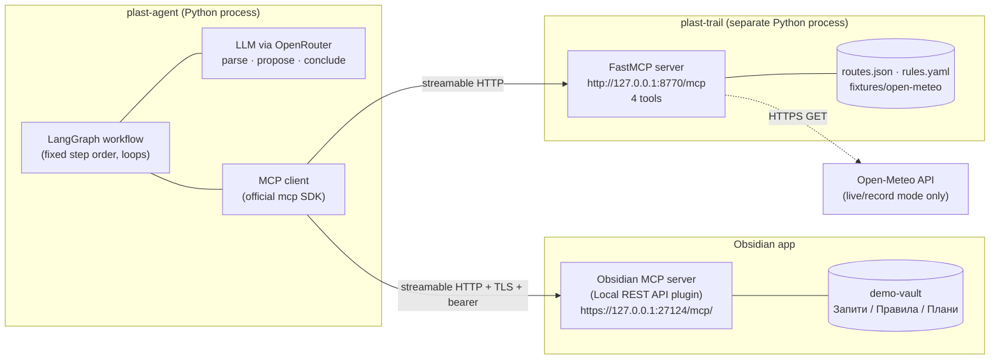

# Design rationale

## 1. The problem

A Plast (Ukrainian scouting) leader planning a multi-day hike has to combine several things: a trail that fits the group's age, safe day lengths, night spots with water, enough adults, the forecast, and what to carry. Today this lives in a leader's head and a few notes. The agent takes the leader's own note, in plain words, and returns a checked plan next to it, with every number traceable to a source.

## 2. Architecture and boundaries



| Layer | Owns | Does not own |
|---|---|---|
| Agent workflow (`src/plast_agent/workflow.py`) | order of steps, loop limits, what goes into each prompt, the feedback assembled from tool results | any domain number, rules, data access |
| LLM | understanding the free-text request; choosing route, night spots and start date; the final paragraph | km, ascent, times, risk levels (always taken from tools) |
| MCP client (`mcp_links.py`) | sessions, discovery, call logging, turning `isError` into exceptions and connection failures into sentences | business logic |
| Obsidian MCP | reading the request, listing requests, writing the plan, appending a link | planning |
| plast-trail MCP | dataset, rules, computation, forecast access, rate limiting, fixtures | conversation, prompts |

Both MCP connections are discovered at start-up (`initialize` + `tools/list`; 20 + 4 tools are printed) and used through `tools/call` only.

## 3. Why Obsidian is the existing server

- **It is where the people are.** The request is written by a leader as a normal note, and the plan has to end up as a normal note next to it: readable on a phone, editable, linkable. The agent reads its *input* from Obsidian and writes its *output* back to it.
- **Its results drive the flow.** The note's content (group size, dates, flexibility, "не більше 12 км на день", "ночувати не вище 1600 м") becomes `group_limits` and arguments for every later tool; these limits override the Plast rules when stricter. A missing note stops the run and triggers `vault_list` to show what exists.
- **Real side effects with clear boundaries.** `vault_write` only under `Плани/`, `vault_append` one line into the request; a dedicated demo vault with fictional data; TLS verified with the plugin's own certificate; key in `.env`.
- The other approved options fit worse: Weather MCP would duplicate what our server already does with Open-Meteo, and Playwright has no natural public page in this workflow.

## 4. Why each custom tool sits behind the MCP boundary

Common reasons: (1) the numbers must be **deterministic and testable**, not produced by a model; (2) the same tools should serve other hosts later: Claude Desktop, or a web app for Plast members, without copying code; (3) data access, rate limits and replay are **encapsulated** in one process; (4) the contract (typed schemas + error codes) is stable while prompts and models change.

| Tool | Why it is a tool and not prompt text or agent code |
|---|---|
| `find_routes` | The only retrieval tool. It is a constrained domain query (section, days, region, features), not a free-text search: it applies section rules (allowed night-spot kinds, daily limits) and returns ids that the other tools accept. Keeps 450 KB of route data out of the model's context. |
| `validate_hike_plan` | The core of the feedback loop. Computing distances, climbs, walking time and sunset from an elevation profile is exactly what a model gets wrong; the tool does it exactly and returns **actionable** violations (codes, limits, a better waypoint id). Rules live in data, not in the prompt. |
| `assess_weather_risk` | Wraps a network API behind domain thresholds: it converts a raw forecast into "high risk on day 2 because of snow above the tree line". It owns caching, throttling, timeouts and the live/record/replay switch, so the agent never talks to Open-Meteo directly. |
| `calculate_supplies` | Turns a validated plan into what the group carries, with every coefficient echoed with its source. Separate from validation because it has different inputs (body weight, weighed rucksacks, coldest night) and answers a different question. |

At least three tools go beyond retrieval: validate (rules + computation), weather (API + rules), supplies (computation). Their responsibilities do not overlap: candidates → feasibility → conditions → logistics.

## 5. How the tools support the workflow

```
read note (Obsidian) → LLM: parse → find_routes → LLM: propose → validate_hike_plan
      ↑                                                   │ invalid: violations + suggested waypoint ids
      └──────────────── back to propose ◄─────────────────┘
validate OK → assess_weather_risk → high? probe other allowed start dates (same tool) → back to propose
            → calculate_supplies → LLM: conclusion → vault_write plan + vault_append link (Obsidian)
```

Feedback actually changes behaviour. In the recorded demo run (14 Nov 2026), attempt 1 (route `r8613349`, start 21 Nov) was valid but HIGH risk (snow above 1400 m). The probes showed 22 Nov high and 23 Nov medium, and attempt 2 moved the start to 23 Nov. Each attempt and the reason it was rejected is written into the plan note ("Як агент дійшов до цього плану").

## 6. Main design decisions and trade-offs

| Decision | Why | Cost |
|---|---|---|
| **Structured workflow (LangGraph) instead of a free ReAct loop: the code, not the model, decides which MCP tool to call** | The brief allows an LLM-backed workflow. A free 120B model is slow (~30 s per call) and limited to 50 requests a day; a fixed order keeps a run at 3–6 model calls, makes every step explainable at the defence, and makes it impossible to skip validation or the weather check. The model still makes the planning decisions (route, night spots, date) from tool results. | Less flexible: the model never selects MCP tools itself, so the tool descriptions guide other hosts (e.g. Claude Desktop, MCP Inspector) rather than this agent. Letting the model call `validate_hike_plan`/`assess_weather_risk` directly is the natural next step. |
| **Every proposal is checked in code before any tool call** | The model is told the rules (route from the candidates, exactly days−1 night spots from the shown options, start date inside the allowed window, no repeat of a rejected plan); the code enforces them and turns a breach into feedback, without spending a tool call. | One more place where the rules live (prompt + check). |
| **Keep the best valid plan** | If all attempts run out, the agent falls back to the best valid plan seen (lowest weather risk) and marks it `risky`, instead of discarding it as `failed`. Weather is cleared whenever a new plan is validated, so a note never mixes data of two attempts. | — |
| **The model chooses, tools compute** | Plans are expressed as waypoint ids; all km, metres and hours come from the server. No fabricated numbers can enter the plan. | Night spots are limited to OSM points of interest. |
| **Date probes run in code** | After a HIGH result the agent calls the weather tool for the other allowed start dates (cheap, deterministic) and gives the facts to the model. Without this, the model sometimes kept the same date for all 4 attempts. | Extra MCP calls (milliseconds in replay, cached in live mode). |
| **Errors vs empty results** | `isError` + JSON `{code, message, hint}` for failures; empty lists or `valid:false` for legitimate "no". The agent turns tool rejections (e.g. a wrong waypoint id) into feedback for the next proposal. | Two paths to handle on the client. |
| **Rules as data with sources and approval status** | `data/rules.yaml` holds every threshold with its source and `approved: false`; every tool result carries `rules_status`, so a draft can never look official. Research with 51 sources is kept in the repo. | Until a Plast leader approves, the plan is explicitly a draft. |
| **No invented numbers where no source exists** | Ascent per day is reported, not judged. There is no default for base gear weight: the leader enters a weighed rucksack, or the tool reports how much of the limit is left for gear. | Some checks are weaker until a leader decides the values. |
| **Forecast at the route's highest point, 16-day fixture per route** | One call per route covers every start date and night spot; the night temperature at lower spots uses the standard 6.5 °C/km lapse rate. Replay works for any date in the recorded window. | One point per route; daily aggregates; replay uses forecasts from the recording date. |
| **Dataset built offline from OSM + SRTM** | Reproducible (`scripts/build_dataset.py`, cached raw downloads), no network at runtime. Heights come from OpenTopoData (counts per request) instead of Open-Meteo's elevation API (counts per coordinate, which hit 429). | A snapshot: trail changes after 2026-11-14 are not seen until rebuilt. |
| **Streamable HTTP for both servers** | The custom server is started independently and can be inspected or reused; the same client code serves both. | Two processes to start for a demo. |
| **TLS verified, not disabled** | The plugin's self-signed certificate is downloaded once and used as the CA. | One extra setup step. |

## 7. Known limitations

**Data**
- OSM coverage: 121 of 160 hiking relations in the area are usable. 25 were skipped as out of range (under 3 or over 90 km), 10 have no name, 4 could not be chained into one line.
- Routes are planned one way. Linear routes may end on a summit; the descent or transfer back is not planned.
- Start and finish labels come from the nearest settlement or point of interest, and some are approximate. Region assignment is by the nearest centre.
- Night spots are OSM points within 300 m of the trail. Campsite tags in OSM are uneven.

**Calculations**
- SRTM 30 m heights with a 10 m hysteresis give approximate ascent.
- Walking time uses the generic Langmuir rule, with no child-specific correction.
- Sunset uses the NOAA approximation (a few minutes off).

**Weather**
- Daily values at a single point. The 12-hour official thresholds are applied to daily sums.
- No avalanche, visibility or lightning-timing logic.
- A forecast is not certainty.

**Rules**
- DRAFT. Several values have no Plast source (km/day for новацтво, adult ratios, weather thresholds) and need a leader's decision; see `research/rules-for-approval.md`.
- No check of protected areas, wartime restrictions or ДСНС registration; these appear as a documents checklist only.

**Supplies**
- Generic coefficients; group gear weight is not included in the pack estimate; no menu.

**Model**
- The free model is non-deterministic and slow. A run may use up to 4 attempts and ends with an explicit `risky`/`failed` status if no plan passes. The model does not call MCP tools itself (see §6).

**Operations**
- Obsidian with the plugin must be open.
- `plast-trail` has no authentication and binds to loopback only, by design.
- Free-model quota is 50 requests a day.

## 8. What could come next

- A web front-end for Plast leaders that reuses the same MCP server.
- Approval workflow for `rules.yaml` by a Plast commission.
- GPX export.
- Return-route planning.
- A tool-calling eval set (expected tool + arguments per request) to compare models, as in lecture 4.
