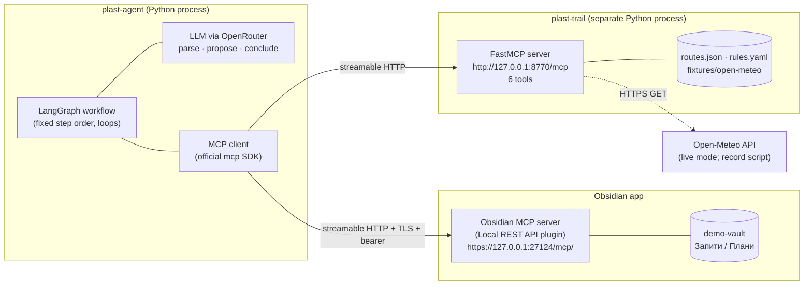

# Design rationale

## 1. The problem

A Plast (Ukrainian scouting) leader planning a multi-day hike has to combine several things: a trail that fits the group's age, safe day lengths, night spots with water, enough adults, the forecast, and what to carry. Today this lives in a leader's head and a few notes. The agent takes the leader's own note, in plain words, and returns a checked plan next to it, with every number traceable to a source.

## 2. Architecture and boundaries



| Layer | Owns | Does not own |
|---|---|---|
| Agent workflow (`src/plast_agent/workflow.py`) | order of steps, loop limits, what goes into each prompt, the feedback assembled from tool results | any domain number, rules, data access |
| LLM | understanding the free-text request; choosing route, night spots and start date; the final paragraph | km, ascent, times, risk levels (always taken from tools) |
| MCP client (`mcp_links.py`) | sessions, discovery, call logging, turning `isError` into exceptions and connection failures into sentences | business logic |
| Obsidian MCP | reading the request, listing requests, writing the plan, appending a link | planning |
| plast-trail MCP | dataset, rules, computation, forecast access, rate limiting, fixtures | conversation, prompts |

Both MCP connections are discovered at start-up (`initialize` + `tools/list`; 20 + 6 tools are printed) and used through `tools/call` only.

## 3. Why Obsidian is the existing server

- **It is where the people are.** The request is written by a leader as a normal note, and the plan has to end up as a normal note next to it: readable on a phone, editable, linkable. The agent reads its *input* from Obsidian and writes its *output* back to it.
- **Its results drive the flow.** The note's content (group size, dates, flexibility, "не більше 12 км на день", "ночувати не вище 1600 м") becomes `group_limits` and arguments for every later tool; these limits override the Plast rules when stricter. A missing note stops the run and triggers `vault_list` to show what exists.
- **Real side effects with clear boundaries.** `vault_write` under `Плани/` (the plan, its picture and track) and, in the dialogue modes, the new request note under `Запити/`; `vault_append` one status line into the request; a dedicated demo vault with fictional data; TLS verified with the plugin's own certificate; key in `.env`.
- The other approved options fit worse: Weather MCP would duplicate what our server already does with Open-Meteo, and Playwright has no natural public page in this workflow.

## 4. Why each custom tool sits behind the MCP boundary

Common reasons: (1) the numbers must be **deterministic and testable**, not produced by a model; (2) the same tools should serve other hosts later: Claude Desktop, or a web app for Plast members, without copying code; (3) data access, rate limits and replay are **encapsulated** in one process; (4) the contract (typed schemas + error codes) is stable while prompts and models change.

| Tool | Why it is a tool and not prompt text or agent code |
|---|---|
| `find_routes` | The route retrieval tool (`resolve_places` is a name lookup; the three tools the rubric hinges on, `validate_hike_plan`, `assess_weather_risk` and `calculate_supplies`, compute, not search). It is a constrained domain query (section, days, region, features), not a free-text search: it applies section rules (allowed night-spot kinds, daily limits) and returns ids that the other tools accept. Keeps 450 KB of route data out of the model's context. |
| `resolve_places` | Leaders write names with typos and in any case form («піпівана», «на Говерлу»). Matching them needs the dataset's 1494 names and find_routes' own matching rule, both of which live in the server; the answer (found / corrected / ambiguous / not_found, region, on how many routes) is something any host can use, e.g. to ask the user which Петрос. Keeps the gazetteer out of the model's context. |
| `validate_hike_plan` | The core of the feedback loop. Computing distances, climbs, walking time and sunset from an elevation profile is exactly what a model gets wrong; the tool does it exactly and returns **actionable** violations (codes, limits, a better waypoint id). Rules live in data, not in the prompt. |
| `assess_weather_risk` | Wraps a network API behind domain thresholds: it converts a raw forecast into "high risk on day 2 because of snow above the tree line". It owns caching, throttling, timeouts and the live/replay switch (recording is a separate script, so the tool never writes), so the agent never talks to Open-Meteo directly. |
| `get_route_profile` | The leader should *see* how hard each day is, not only read numbers. From the same data the agent also writes a GPX track (per day, with heights and night spots) and Mapy.com links (outdoor map + interactive elevation profile, for the whole route, each day and a side trip to a wished place), so the real map is one click away without an Obsidian plugin. When the Obsidian Leaflet community plugin is installed (`OBSIDIAN_LEAFLET=1`: the agent cannot detect it, since the REST API may not read `.obsidian/` and the plugin adds no commands), the note also gets an interactive map: the GPX on OpenTopoMap (a satellite layer to switch to) with the night spots and the wished places. Lessons from the first versions, each now covered by a test:
  - the plugin parses the block as YAML, so a colon in a marker name or repeated `marker:` keys made the map blank;
  - `zoomFeatures` fitted the view before the GPX loaded and left a grey map;
  - the plugin's default base map (CARTO) now needs a key;
  - OpenTopoMap has only the subdomains a–c. The profile and coordinates are in the server's dataset; the tool returns them per day with the same climb/drop as validation, so the picture never disagrees with the plan. It returns data, not an image: the agent draws the SVG for Obsidian, a web app could draw it its own way. |
| `calculate_supplies` | Turns a validated plan into what the group carries, with every coefficient echoed with its source. Separate from validation because it has different inputs (body weight, weighed rucksacks, coldest night) and answers a different question. |

At least three tools go beyond retrieval: validate (rules + computation), weather (API + rules), supplies (computation). Their responsibilities do not overlap: names → candidates → feasibility → conditions → logistics.

## 5. How the tools support the workflow

```
read note (Obsidian) → LLM: parse → code checks → resolve_places → find_routes → LLM: propose → validate_hike_plan
      ↑                                                   │ invalid: violations + suggested waypoint ids
      └──────────────── back to propose ◄─────────────────┘
validate OK → assess_weather_risk → high? probe other allowed start dates (same tool) → back to propose
            → calculate_supplies → get_route_profile → LLM: conclusion
            → vault_write route picture (SVG) + plan note embedding it, vault_append link (Obsidian)
```

Feedback actually changes behaviour. In the recorded demo run (14 Nov 2026), attempt 1 (route `r8613349`, start 21 Nov) was valid but HIGH risk (snow above 1400 m). The probes showed 22 Nov high and 23 Nov medium, and attempt 2 moved the start to 23 Nov. Each attempt and the reason it was rejected is written into the plan note ("Як агент дійшов до цього плану").

## 6. Main design decisions and trade-offs

| Decision | Why | Cost |
|---|---|---|
| **Structured workflow (LangGraph) instead of a free ReAct loop: the code, not the model, decides which MCP tool to call** | The brief allows an LLM-backed workflow. A free 120B model is slow (~30 s per call) and limited to 50 requests a day; a fixed order keeps a run at 3–6 model calls, makes every step explainable at the defence, and makes it impossible to skip validation or the weather check. The model still makes the planning decisions (route, night spots, date) from tool results. | Less flexible: the model never selects MCP tools itself, so the tool descriptions guide other hosts (e.g. Claude Desktop, MCP Inspector) rather than this agent. Letting the model call `validate_hike_plan`/`assess_weather_risk` directly is the natural next step. |
| **Every proposal is checked in code before any tool call** | The model is told the rules (route from the candidates, exactly days−1 night spots from the shown options, start date inside the allowed window, no repeat of a rejected plan); the code enforces them and turns a breach into feedback, without spending a tool call. | One more place where the rules live (prompt + check). |
| **Chat mode with clarifying questions** | `--chat`: the leader types the request; the agent shows what it understood, asks only for missing facts, lets the leader correct it, then saves the request to Obsidian and plans as for a note. Obsidian stays the record of the request. The model reads the description **once**; short answers («2», «я думаю 1 буду», «19 листопада», «не важливо») are read by code, and «не важливо» for days or the date becomes a stated assumption (2 days; the next Saturday with a 3-day shift). In the real session of 15 Nov every answer cost a model request and the 5th hit the daily limit. | The model re-reads only an answer the code cannot read, or a correction. |
| **The model reads once, code checks the reading** | `understanding.refine` checks the model's fields against the words of the text: wishes (озеро, колиба…) only if the word is there; the region from the region's name in the text (a Latin name inside the note is treated as an injected instruction); places without region names, Latin junk or names absent from the text; the participant count from «10 юнаків» (not an age «13–15 років», not «учасник — 5 кг», not last year's group); adults only from an unambiguous phrase; 0 adults for children only if the text says so; the group only if the text supports that group; the start time, an explicit date, the date shift and group limits only with their own words around the number. Measured on the dev set (`eval/RESULTS.md`): the cloud model 93 % → 100 % of requests with all 5 core fields right, the local model 22 % → 80 % (97 % without a silent error in the core fields). | Word lists in code need care; the held-out test set was partly seen while writing them (`eval/README.md`). Misspelt names are corrected by `resolve_places` (below). |
| **Understanding is measured, not assumed** | 60 labelled requests (30 dev for improving, 30 held-out test), 17 fields each, scored as correct / missing (safe: the agent asks) / invented / wrong (silent errors), with a 95 % Wilson interval. Model answers are saved, so a code-only change is re-scored without any model call (`--replay`); OpenRouter runs stop at a quota reserve and resume next day. | 30 requests give ±15 points; small differences are not proof. |
| **Too few adults is advice, not a failed plan; safety still comes first** | `TOO_FEW_ADULTS`, `ADULT_RATIO`, `GROUP_TOO_LARGE`, `TOO_MANY_DAYS` cannot be fixed by another route or date, so the loop does not spend more proposals on them. Only too few adults becomes status `group` (the leader's decision); a high or unknown forecast still makes the plan `risky` with the escort advice next to it, and too many days for the group fails the plan (`plan_status` in `workflow.py`). With status `group` the plan is finished (weather, supplies, picture), and the note says «за можливості візьміть ще дорослого на супровід». The leader decided this on 15 Nov after a test where 1 adult with 7 youths ended as `failed` with no route shown. | The rule stays an error in `rules.yaml` (sourced: UPYu guidelines); only the presentation is softer, and the note still states the norm. |
| **A named place on no route: the nearest routes** | Бребенескул lies on the main ridge, which only the long trails (> 90 km, not in the dataset) follow. Instead of ignoring the wish, `find_routes` looks the place up in the gazetteer and ranks routes by how close they come to it (70 % closeness, 30 % km/day fit; farther than 8 km is dropped). The plan names the distance, the picture draws the place as a star with a dashed line, and the note lists the other options. | A side trip to the place is not planned or checked; the real fix is splitting the long trails (§8). |
| **Model chain: OpenRouter → local Ollama** | The free quota is 50 requests/day, shared by all free models, so another free model would not help. A local model (Gemma 4 E4B on a 16 GB Mac, 12B on bigger machines; `ollama/Modelfile` with an 8192 context; answers capped at 700 tokens for structured readings and 900 for text) keeps the agent working offline and without limits. The switch happens on 429/timeout/5xx/schema failure, and a 429 is remembered until 00:00 UTC. For Ollama: `json_schema` with a **plain** (non-strict) schema checked by pydantic, and `reasoning_effort="none"`. | Three measured traps: gemma4 "thinks" by default (20+ s, a hot fanless laptop); langchain sends the token cap as `max_completion_tokens`, which Ollama ignores; the strict schema (all 17 fields required) made the model loop on whitespace in 11 of 30 readings. With all three fixed: 3.8 s median, no failures in 30 readings. The model still reads worse than the cloud one, so the code checks matter most for it. |
| **Hard deadlines on model calls** | OpenRouter keeps slow free-model connections alive, so an HTTP read timeout may never fire. Every model call has a wall-clock deadline (OpenRouter 120 s / 45 s, Ollama 180 s / 90 s). | A slow but correct answer can be cut off; the run reports it plainly. |
| **Keep the best valid plan** | If all attempts run out, the agent falls back to the best valid plan seen (lowest weather risk) and marks it `risky`, instead of discarding it as `failed`. Weather is cleared whenever a new plan is validated, so a note never mixes data of two attempts. | — |
| **The model chooses, tools compute** | Plans are expressed as waypoint ids; all km, metres and hours come from the server. The request's core facts (group, people, adults, days, date) are checked against the text: what the text states beats the model, the latest correction beats the first message, and a fact the model filled with nothing in the text behind it is asked again. The closing paragraph may not contain digits at all: if the model writes any, the paragraph is replaced by one written from the tool results, so every number in a plan comes from a tool. | Night spots are limited to OSM points of interest. |
| **Date probes run in code** | After a HIGH result the agent calls the weather tool for the other allowed start dates (cheap, deterministic) and gives the facts to the model. Without this, the model sometimes kept the same date for all 4 attempts. | Extra MCP calls (milliseconds in replay, cached in live mode). |
| **Errors vs empty results** | `isError` + JSON `{code, message, hint}` for failures; empty lists or `valid:false` for legitimate "no". The agent turns tool rejections (e.g. a wrong waypoint id) into feedback for the next proposal. | Two paths to handle on the client. |
| **Rules as data with sources and approval status** | `data/rules.yaml` holds every threshold with its source and its approval (`approved`, `approved_by`, version); every result of the tools that apply the norms (`find_routes`, `validate_hike_plan`, `assess_weather_risk`) carries `rules_status`, so a draft can never look official. Research with 51 sources is kept in the repo. | The leader approved the 59 values that were still proposals (the 60th, the thunderstorm codes, was approved from the start) for this project on 16 Nov 2026; before that every plan said «чернетка». Approval for the project is not adoption by Plast. |
| **No invented numbers where no source exists** | Ascent per day is reported, not judged. There is no default for base gear weight: the leader enters a weighed rucksack, or the tool reports how much of the limit is left for gear. | Some checks are weaker until a leader decides the values. |
| **Forecast at the route's highest point, 16-day fixture per route** | One call per route covers every start date and night spot; the night temperature at lower spots uses the standard 6.5 °C/km lapse rate. Replay works for any date in the recorded window. | One point per route; daily aggregates; replay uses forecasts from the recording date. |
| **Dataset built offline from OSM + SRTM** | Reproducible (`scripts/build_dataset.py`, cached raw downloads), no network at runtime. Heights come from OpenTopoData (counts per request) instead of Open-Meteo's elevation API (counts per coordinate, which hit 429). | A snapshot: trail changes after 2026-11-14 are not seen until rebuilt. |
| **Streamable HTTP for both servers** | The custom server is started independently and can be inspected or reused; the same client code serves both. | Two processes to start for a demo. |
| **TLS verified, not disabled** | The plugin's self-signed certificate is downloaded once and used as the CA. | One extra setup step. |

## 7. Known limitations

**Data**
- OSM coverage: 121 of 160 hiking relations in the area are usable. 25 were skipped as out of range (under 3 or over 90 km), 10 have no name, 4 could not be chained into one line.
- Routes are planned one way. Linear routes may end on a summit; the descent or transfer back is not planned.
- Start and finish labels come from the nearest settlement or point of interest, and some are approximate. Region assignment is by the nearest centre.
- Night spots are OSM points within 300 m of the trail. Campsite tags in OSM are uneven.
- Each point of interest gets one km position, so loops and out-and-back routes see it only once.

**Calculations**
- SRTM 30 m heights with a 10 m hysteresis give approximate ascent.
- Walking time uses the generic Langmuir rule, with no child-specific correction.
- Sunset uses the NOAA approximation (a few minutes off).

**Weather**
- Daily values at a single point. The 12-hour official thresholds are applied to daily sums. The wind thresholds (15 / 25 m/s) apply to the stronger of steady wind and gusts (the leader's decision, 16 Nov 2026): in the recorded forecasts steady wind never reached 15 m/s, gusts did on 24 % of route-days, so this makes the agent markedly more cautious on the ridges.
- An incomplete forecast for a planned day is reported as `WEATHER_UNAVAILABLE`, never filled with zeros.
- No avalanche, visibility or lightning-timing logic.
- A forecast is not certainty.

**Rules**
- Approved for this project by its leader (16 Nov 2026), but several values have no Plast source (km/day for новацтво, adult ratios, weather thresholds): they are accepted proposals, marked `PROPOSAL` in their source. Questions only Plast can settle are open: `research/plast-norms-research.md`, section 5.
- No check of protected areas, wartime restrictions or ДСНС registration; these appear as a documents checklist only.

**Supplies**
- Generic coefficients; group gear weight is not included in the pack estimate; no menu. The pack is the peak weight (all food + flask + dry-night water if any night is dry).

**Language**
- Tool messages are English (for models); the plan note is Ukrainian, built from the stable codes. The tools' fix suggestions stay English in the note, labelled as the tool's advice.

**Model**
- The free model is non-deterministic and slow. A run may use up to 4 attempts and ends with an explicit `risky`/`failed` status if no plan passes. The model does not call MCP tools itself (see §6).

**Operations**
- Obsidian with the plugin must be open.
- `plast-trail` has no authentication and binds to loopback only, by design.
- Free-model quota is 50 requests a day.

## 8. What could come next

- A web front-end for Plast leaders that reuses the same MCP server.
- Approval workflow for `rules.yaml` by a Plast commission.
- A per-day elevation chart inside the interactive map (today: the offline picture's profile and Mapy.com's).
- Return-route planning.
- Find named places the model missed by looking up the text's words in the gazetteer (now only the names the model lists are resolved).
- Split the long trails (> 90 km) into sections, so ridge traverses such as Піп Іван → Бребенескул → Говерла can be planned.
- Real requests from Plast leaders as the truly held-out test set.
- A tool-calling eval set (expected tool + arguments per request) to compare models, as in lecture 4.
